# Ironhaven

Infrastructure AWS sécurisée et reproductible, provisionnée avec Terraform, configurée avec Ansible et administrée sans exposition publique de SSH.

## Objectif du projet

Ironhaven est un projet pratique consacré au cycle de vie complet d’une infrastructure cloud sécurisée : provisionnement, configuration, durcissement, validation, supervision et destruction contrôlée.

L’objectif est de construire une architecture AWS segmentée et reproductible, puis d’automatiser sa configuration et ses contrôles de sécurité. Une attention particulière est portée au principe du moindre privilège, à la traçabilité, à la maintenabilité et à la maîtrise des coûts.

## Architecture

Ironhaven est déployé en région AWS `eu-west-3` dans un
VPC `10.42.0.0/16` segmenté en trois couches.

| Couche | Ressource | Réseau |
|---|---|---|
| Management | EC2 Amazon Linux 2023 | 10.42.10.21 |
| Application | EC2 Amazon Linux 2023 | 10.42.20.104 |
| Données | RDS PostgreSQL | Sous-réseaux privés |

L'infrastructure comprend :

- quatre subnets : public, application et deux subnets de données ;
- une Internet Gateway et une NAT Gateway ;
- des tables de routage publique et privée ;
- trois Security Groups aux flux restrictifs ;
- deux instances EC2 administrées sans SSH via Systems Manager ;
- des rôles IAM distincts pour management et application ;
- un bucket S3 privé pour les transferts Ansible ;
- un service Nginx conteneurisé sur management ;
- une base PostgreSQL RDS privée et chiffrée ;
- un secret RDS géré par AWS Secrets Manager ;
- des journaux et métriques CloudWatch ;
- une analyse Trivy automatisée avec GitHub Actions.

L'EC2 applicative n'a aucune adresse IPv4 publique.
Le port PostgreSQL `5432` est autorisé depuis le
Security Group applicatif uniquement.

La validation initiale par SSM utilisait provisoirement le compte maître RDS.
Depuis, l'API a été migrée vers une authentification IAM en lecture seule
avec TLS `verify-full`, sans autorisation de lecture du secret maître.

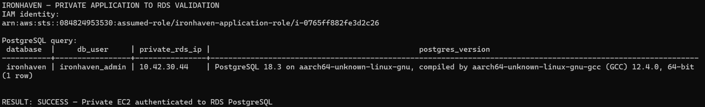

Le service Flask/Gunicorn de la couche applicative est déployé avec Ansible et supervisé par systemd.
Les endpoints `/health` et `/records` ont été testés depuis l'instance management et retournent des données de RDS.
Le Nginx existant sur management reste un service de démonstration distinct.

### Documentation technique

- [Architecture AWS](docs/architecture.md)
- [Administration Ansible](docs/ansible.md)
- [Conteneur Nginx](docs/container.md)
- [CloudWatch](docs/monitoring.md)
- [PostgreSQL et validation RDS](docs/database.md)
- [Analyse Trivy et CI](docs/security-scanning.md)
- [Décisions techniques](docs/decisions.md)
- [Troubleshooting](docs/troubleshooting.md)

## Sécurité

Les principaux contrôles actuellement appliqués sont :

- authentification MFA pour l’utilisateur AWS du projet ;
- politiques IAM dédiées aux opérations du projet ;
- segmentation réseau en couches management, application et données ;
- groupes de sécurité restrictifs utilisant des références entre groupes ;
- absence de règle entrante ouverte sur Internet ;
- administration par AWS Systems Manager Session Manager ;
- métadonnées EC2 limitées à IMDSv2 ;
- volume système chiffré ;
- bucket de transfert Ansible chiffré, privé et nettoyé automatiquement ;
- synchronisation temporelle avec `chronyd` ;
- journalisation système avec `auditd` ;
- authentification SSH par mot de passe et connexion directe de `root` désactivées ;
- service Nginx lié uniquement à l’interface locale ;
- contenu web monté en lecture seule dans le conteneur ;
- validation automatique de la réponse HTTP ;
- analyse des vulnérabilités de l’image avec Trivy ;
- blocage du pipeline sur les vulnérabilités corrigibles `HIGH` ou `CRITICAL` ;
- dépendances CI externes épinglées par SHA ou digest ;
- centralisation des journaux système, d’audit et Docker dans CloudWatch ;
- rétention des journaux CloudWatch limitée à sept jours ;
- instance RDS privée avec stockage chiffré ;
- application authentifiée à PostgreSQL via IAM, sans mot de passe applicatif permanent ;
- utilisateur SQL `ironhaven_reader` en lecture seule ;
- connexion PostgreSQL avec vérification TLS `verify-full` ;
- accès au secret administrateur RDS refusé au rôle applicatif ;
- gestion du secret maître RDS par Secrets Manager ; rotation périodique à vérifier ;
- exclusion du state Terraform et des informations sensibles du dépôt Git.

## Automatisation Ansible

Les playbooks de base ci-dessous sont disponibles (ainsi que les playbooks applicatifs et PostgreSQL) :

| Playbook | Fonction |
|---|---|
| `baseline.yml` | Mise à jour, outils d’administration, synchronisation temporelle, audit et durcissement SSH |
| `container.yml` | Installation de Docker, construction et déploiement du service Nginx conteneurisé |
| `monitoring.yml` | Installation et configuration de l’agent Amazon CloudWatch |

Les trois playbooks ont été exécutés une seconde fois avec :

```text
changed=0
unreachable=0
failed=0
```

Ce résultat confirme leur idempotence sur l’environnement déployé. Les collections nécessaires sont versionnées dans `ansible/requirements.yml`.

## Supervision

L’agent Amazon CloudWatch collecte :

- les journaux d’initialisation de l’instance ;
- les événements produits par `auditd` ;
- les journaux du conteneur Docker ;
- le pourcentage de mémoire utilisée ;
- le pourcentage d’espace utilisé sur la partition racine.

Les journaux sont répartis dans trois groupes CloudWatch gérés par Terraform. Les métriques sont publiées dans l’espace de noms `Ironhaven/Management`.

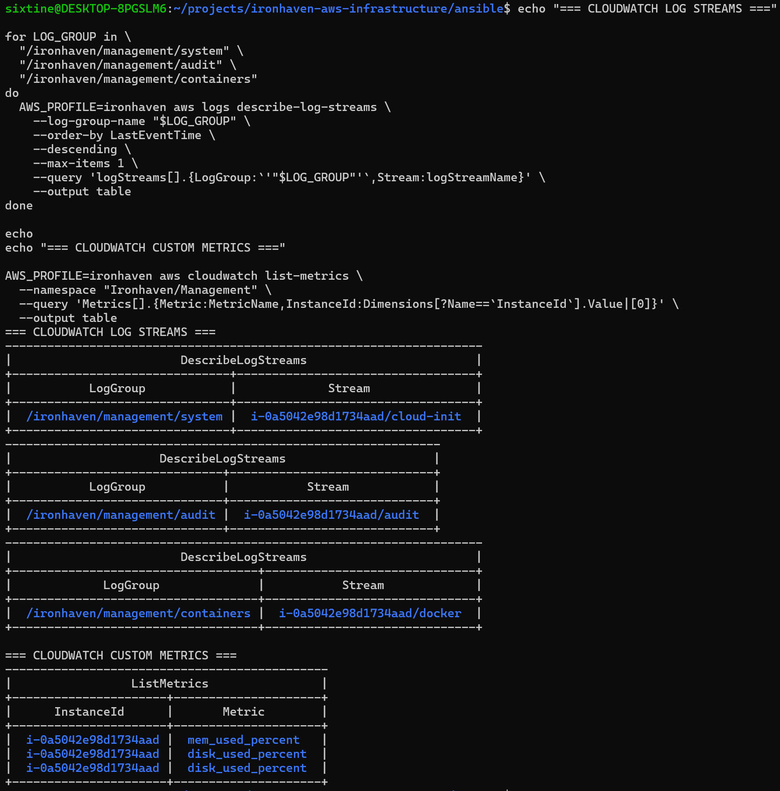

## Sécurité des conteneurs

L’image Nginx initiale contenait des vulnérabilités corrigibles de sévérité `HIGH` ou `CRITICAL`. Après mise à jour de l’image de base et application des correctifs Alpine pendant le build, Trivy ne détecte plus aucune vulnérabilité correspondant à cette politique.

Le workflow GitHub Actions reconstruit et analyse l’image à chaque push et pull request vers `main`. Le job échoue automatiquement si une vulnérabilité corrigible `HIGH` ou `CRITICAL` est détectée.

## Base de données

Amazon RDS héberge une instance PostgreSQL dans deux sous-réseaux privés répartis sur deux zones de disponibilité. L’instance n’est pas publiquement accessible, son stockage est chiffré et ses journaux PostgreSQL sont exportés vers CloudWatch.

Le mot de passe principal n’est ni défini dans Terraform ni stocké dans le dépôt. RDS le génère et le conserve dans Secrets Manager. La rotation automatique doit encore être vérifiée.

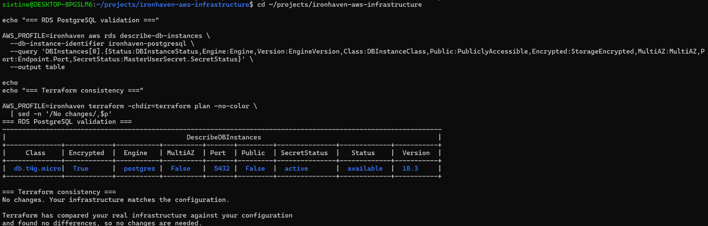

## Technologies

### Actuellement utilisées

- AWS
- Terraform
- Ansible
- Docker
- Nginx
- PostgreSQL
- Trivy
- GitHub Actions
- Amazon CloudWatch
- Amazon RDS
- AWS Secrets Manager
- AWS IAM
- AWS Systems Manager
- Amazon EC2
- Amazon S3
- Amazon Linux 2023
- Git et GitHub
- WSL2 Ubuntu

### Prévue

- composant de sécurité pour agent IA

## État du projet

### Réalisé et validé

- [x] Authentification AWS avec identifiants temporaires et MFA
- [x] Provisionnement Terraform du VPC et des quatre subnets
- [x] Internet Gateway, NAT Gateway et routage privé
- [x] Security Groups restrictifs
- [x] EC2 management et administration SSM
- [x] Automatisation Ansible via SSM et bucket S3
- [x] Durcissement Linux et configuration de base
- [x] Docker et Nginx sur management
- [x] Tests HTTP du service Nginx
- [x] CloudWatch Logs et métriques système
- [x] Analyse Trivy et remédiation des vulnérabilités
- [x] Pipeline GitHub Actions de sécurité
- [x] RDS PostgreSQL privée avec stockage chiffré
- [x] Gestion du secret maître avec Secrets Manager
- [x] EC2 applicative privée sans IP publique
- [x] Rôle IAM applicatif dédié
- [x] Connexion SSM sur l'EC2 applicative
- [x] Résolution DNS et connectivité PostgreSQL TCP 5432
- [x] Lecture historique du secret RDS depuis le rôle IAM applicatif (droit désormais révoqué)
- [x] Connexion PostgreSQL et requête SQL réelle
- [x] Capture de validation SQL publiée sur GitHub

### À terminer

- [x] Déployer le service HTTP dans la couche applicative
- [x] Automatiser son déploiement avec Ansible
- [x] Tester HTTP depuis management vers application
- [x] Tester l'intégration HTTP vers PostgreSQL
- [x] Collecter les preuves visuelles du flux applicatif et de la sécurité IAM
- [ ] Vérifier la reconstruction complète ; le state S3 a déjà été migré et le plan final était sans dérive
- [ ] Contrôler les coûts et nettoyer les ressources AWS

L'extension expérimentale de sécurité pour agent IA
reste hors du périmètre de livraison de cette V1.

## Structure du dépôt

```text
.
├── .github/
│   └── workflows/
│       └── container-security.yml
├── ansible/
│   ├── ansible.cfg
│   ├── files/
│   │   └── nginx/
│   │       └── Dockerfile
│   ├── inventory/
│   │   └── hosts.yml
│   ├── playbooks/
│   │   ├── baseline.yml
│   │   ├── container.yml
│   │   └── monitoring.yml
│   └── requirements.yml
├── docs/
│   ├── ansible.md
│   ├── architecture.md
│   ├── container.md
│   ├── database.md
│   ├── decisions.md
│   ├── monitoring.md
│   ├── security-scanning.md
│   ├── troubleshooting.md
│   └── screenshots/
└── terraform/
    ├── application.tf
    ├── compute.tf
    ├── database.tf
    ├── iam.tf
    ├── monitoring.tf
    ├── network.tf
    ├── outputs.tf
    ├── provider.tf
    ├── routing.tf
    ├── security.tf
    ├── storage.tf
    ├── variables.tf
    └── versions.tf
```

## Maîtrise des coûts

L'environnement est temporaire et son coût est surveillé.

- Les instances EC2 peuvent être arrêtées entre les sessions.
- RDS peut être arrêtée temporairement, mais son stockage
  et ses sauvegardes peuvent rester facturés.
- La NAT Gateway est facturée tant qu'elle reste provisionnée,
  même lorsque les instances sont arrêtées.
- Les journaux CloudWatch sont conservés sept jours.
- Les objets temporaires du bucket S3 expirent automatiquement.
- Les fichiers `.tfstate`, `.tfvars` et `.tfplan`
  sont exclus du dépôt Git.

Une destruction contrôlée est prévue après les validations
finales, sous réserve de sauvegarder les livrables utiles.

## Avertissement

Ce dépôt correspond à un environnement de laboratoire et de démonstration. Les ressources AWS sont temporaires et doivent être arrêtées ou détruites lorsqu’elles ne sont pas utilisées afin de limiter les coûts.

## Démonstration de sécurité applicative

L'application Flask est exécutée sur une EC2 privée et gérée
par systemd. Elle utilise le rôle IAM de l'instance pour générer
des jetons temporaires d'authentification PostgreSQL.

La connexion RDS emploie `sslmode=verify-full` avec le bundle
d'autorités de certification Amazon RDS. Le compte SQL
`ironhaven_reader` n'a que le droit `SELECT` sur la table
`public.ironhaven_components`.

Le secret administrateur RDS reste géré par AWS Secrets Manager,
mais le rôle IAM applicatif ne dispose plus de sa permission
`secretsmanager:GetSecretValue`.

### Validation du parcours complet

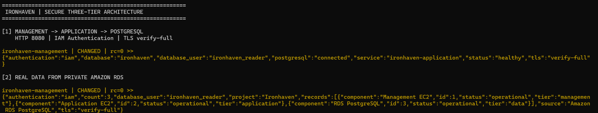

### Lecture seule et vérification TLS

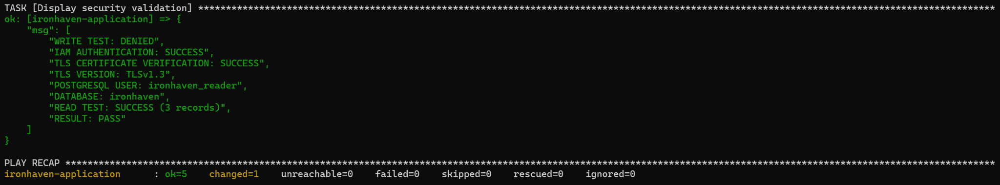

### Refus d'accès au secret administrateur

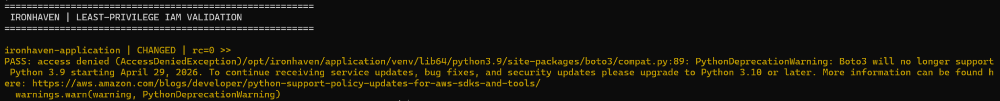

Les captures correspondent à des validations effectuées
sur l'environnement AWS déployé. Le transport HTTP entre
management et application reste interne au VPC et n'est
pas chiffré au niveau applicatif ; le lien application-RDS
est protégé par TLS avec vérification du certificat.

## Terraform Remote State — Amazon S3

L'état Terraform a été migré du stockage local vers un bucket
Amazon S3 indépendant de l'infrastructure principale.

- Région : `eu-west-3`
- Chiffrement au repos : SSE-S3 (`AES256`)
- Versioning S3 activé
- Blocage complet des accès publics
- Politique S3 refusant les connexions non HTTPS
- Verrouillage natif Terraform : `use_lockfile = true`
- Sauvegarde locale conservée hors dépôt avant migration

La migration a été vérifiée avec `terraform plan` :
**No changes — aucune dérive détectée.**

Le bucket de state est géré séparément afin qu'une destruction
de l'infrastructure applicative ne supprime pas son propre état.

### Sécurité du stockage

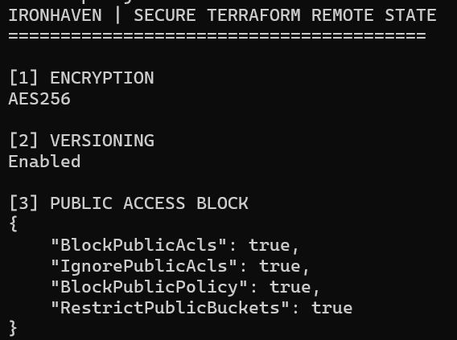

### Validation de la migration

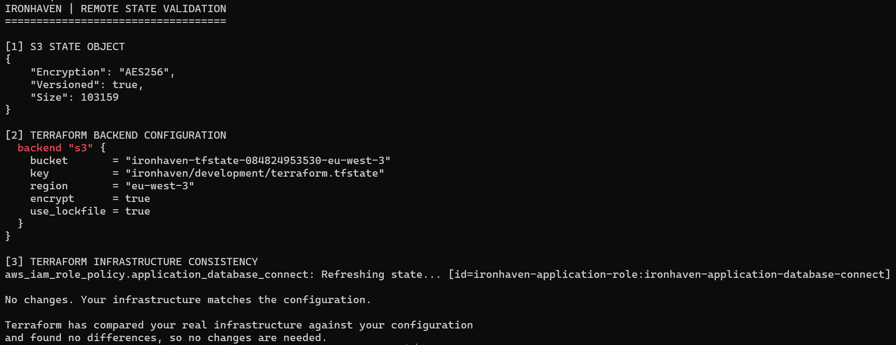

La configuration du backend est versionnée dans
`terraform/backend.tf`. Le contenu réel du state,
potentiellement sensible, reste exclu de Git.

**Limite :** le verrouillage S3 est configuré ; un test
explicite de concurrence reste à réaliser.

## CI/CD et authentification AWS OIDC

Ironhaven utilise trois workflows GitHub Actions :

- **Container security** : construction de l'image Nginx et
  analyse Trivy des vulnérabilités HIGH/CRITICAL corrigibles.
- **Infrastructure CI** : contrôles Terraform (`fmt`, `validate`),
  validation YAML Ansible et syntaxe Python.
- **AWS OIDC Validation** : authentification fédérée auprès
  d'AWS STS avec un jeton GitHub temporaire, sans clé AWS
  permanente enregistrée dans GitHub.

La politique de confiance IAM du rôle OIDC est restreinte
au dépôt Ironhaven, à la branche `main` et à l'audience
`sts.amazonaws.com`.

Le rôle `ironhaven-github-oidc-validation` n'a aucune
permission d'accès aux ressources AWS. Ce workflow
valide exclusivement l'identité fédérée : il ne déploie
aucune infrastructure.

### CI infrastructure validée

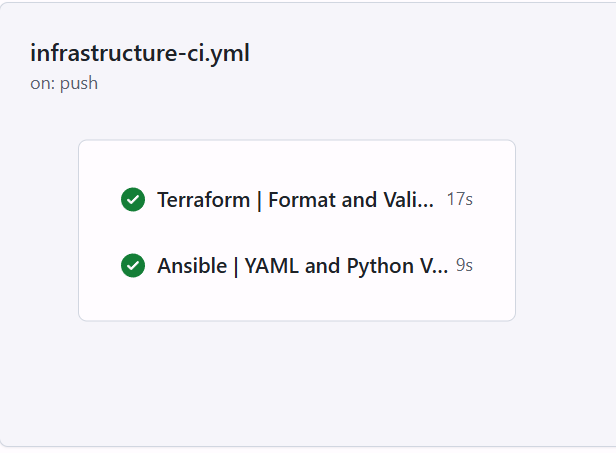

### Authentification AWS OIDC validée

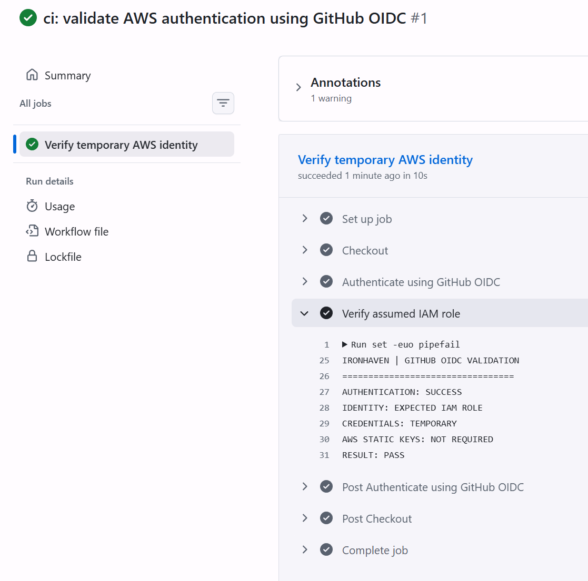

**Limites :** ces validations ne constituent pas encore
une chaîne de déploiement continu. Les tests Ansible
portent ici sur les fichiers YAML et Python, et non sur
une exécution réelle des playbooks en CI.

## Bootstrap PostgreSQL reproductible

Le provisionnement SQL est désormais séparé du rôle IAM
de l'application.

Un script local utilise un tunnel AWS Systems Manager vers
RDS, récupère le secret maître avec l'identité administrative
du poste WSL et configure le compte SQL `ironhaven_reader`.

Deux exécutions successives ont été validées sans duplication
des données. Une reconstruction intégrale depuis zéro reste
à vérifier.

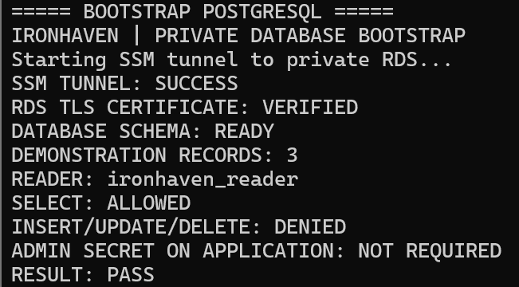
