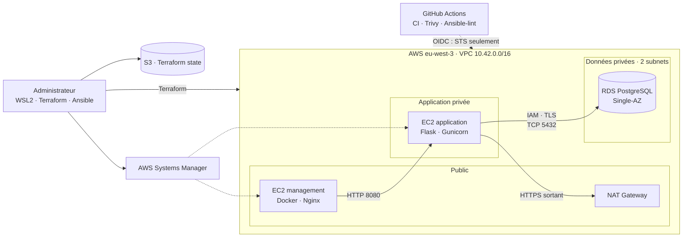
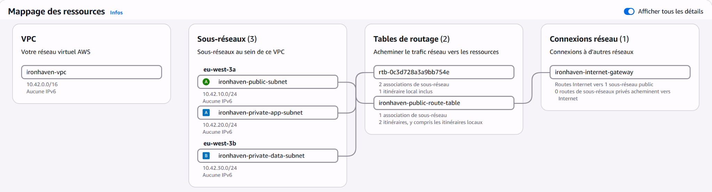
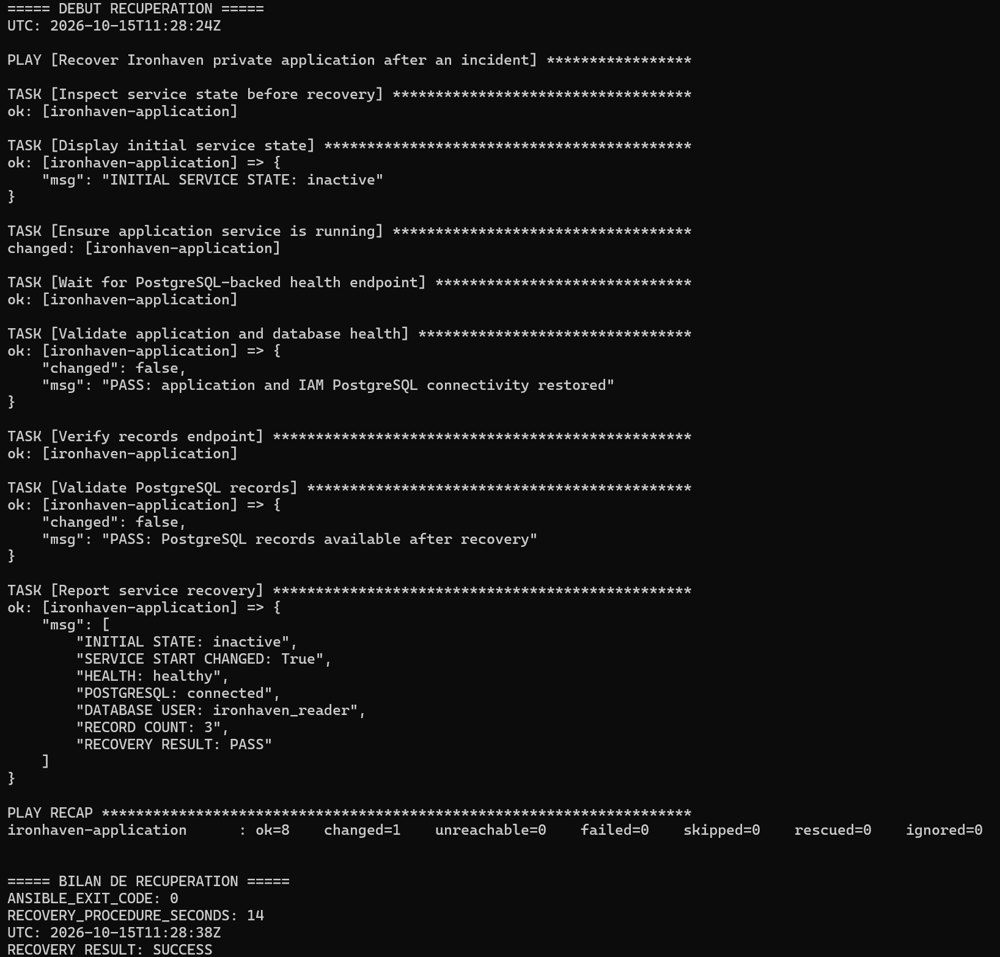

# Ironhaven — AWS Infrastructure & Security

**Infrastructure cloud à trois couches, provisionnée avec Terraform, administrée avec Ansible et AWS Systems Manager, et validée par des tests réels de sécurité et d'exploitation.**

**Stack :** AWS · Terraform · Ansible · Linux · Docker · PostgreSQL · Python · GitHub Actions · Trivy

> **Statut :** V1 fonctionnelle et validée en octobre 2026. Laboratoire temporaire destiné à être détruit après les validations finales. Les résultats présentés correspondent aux tests réalisés, et non à un service de production permanent.

## Vue d'ensemble

Ironhaven est un projet personnel d'administration systèmes, de cloud et de cybersécurité visant à couvrir le cycle de vie d'une infrastructure : conception, déploiement, configuration, sécurisation, supervision, diagnostic et fermeture.

Le projet a été exécuté sur un véritable compte AWS dans la région **Paris (`eu-west-3`)**, avec un poste de contrôle **Windows 11 / WSL2 Ubuntu**.

### Architecture

**Segmentation :** quatre sous-réseaux, trois Security Groups, aucune règle entrante depuis Internet, EC2 applicative et RDS sans IP publique. L'EC2 management possède une IP publique pour ses accès sortants, mais aucun port entrant autorisé.

Le schéma est volontairement simplifié : voir [l'architecture détaillée](docs/architecture.md) pour les routes, règles réseau et composants IAM.

## Résultats techniques vérifiés

| Domaine | Implémentation et résultat observé |
|---|---|
| Infrastructure as Code | VPC, EC2, NAT Gateway, RDS, IAM, S3, CloudWatch et alarmes provisionnés avec Terraform |
| État Terraform | Backend S3 privé, versionné, chiffré et verrouillage natif configuré ; plan final sans dérive |
| Administration Linux | Ansible via Session Manager, sans SSH entrant ni clé privée d'administration |
| Automatisation | Configuration système et services via playbooks ; idempotence vérifiée sur les services testés |
| Application | API Flask/Gunicorn privée, endpoints `/health` et `/records` vérifiés |
| PostgreSQL | Connexion IAM avec `ironhaven_reader`, TLS `verify-full`, lecture autorisée et écriture refusée |
| Secrets | Accès au secret administrateur refusé au rôle IAM applicatif |
| Conteneur | Nginx sur Docker, accessible uniquement en loopback et via tunnel SSM |
| Sécurité des conteneurs | Image Nginx corrigée ; aucune vulnérabilité *corrigible* HIGH/CRITICAL détectée selon la politique Trivy lors des tests |
| Supervision | Logs management, métriques mémoire/disque et trois alarmes CloudWatch |
| CI | Terraform `fmt`/`validate`, syntaxe YAML/Python, Trivy et Ansible-lint |
| GitHub OIDC | Identité AWS temporaire vérifiée via STS, sans clé statique dans GitHub |
| Incident Recovery | Arrêt contrôlé du service, diagnostic distant, récupération en 14 secondes d'exécution Ansible et vérification d'idempotence |

**Important :** les 14 secondes correspondent à la durée d'exécution du playbook pendant un exercice unique, et non à un RTO garanti. La reprise du service arrêté a été testée avec la première version du playbook ; la version corrigée a été validée ensuite sur un service déjà actif.

## Sécurité et décisions d'architecture

### Réseau et accès

Les flux applicatifs sont limités par référence entre Security Groups : management vers application sur TCP 8080, puis application vers PostgreSQL sur TCP 5432.

L'accès administratif repose sur **AWS Systems Manager**, avec des rôles IAM EC2 dédiés. Aucun port SSH public n'est nécessaire.

La NAT Gateway permet les sorties HTTPS de la couche applicative privée. Les sous-réseaux de données ne disposent pas de route Internet par défaut configurée par le projet.

### PostgreSQL : séparation des privilèges

La première connexion SQL a été validée avec le compte administrateur RDS. La configuration finale de l'application utilise ensuite :

- le compte PostgreSQL `ironhaven_reader` ;
- une autorisation IAM `rds-db:connect` ciblée ;
- un jeton d'authentification temporaire ;
- TLS avec vérification du certificat et du nom du serveur ;
- `SELECT` autorisé sur la table de démonstration ;
- `INSERT`, `UPDATE` et `DELETE` refusés ;
- aucun accès du rôle applicatif au secret administrateur.

Le script Python [`bootstrap_database.py`](ansible/scripts/bootstrap_database.py) prépare et vérifie le schéma, les données et le compte lecteur par un tunnel SSM. Deux exécutions sur la base existante ont été validées.

[Documentation PostgreSQL et preuves](docs/database.md)

### Risques identifiés et limites

Le contrôle Trivy IaC conserve quatre alertes connues : une `AWS-0164`, deux `AWS-0104` et une `AWS-0132`. Elles sont documentées et soumises à un contrôle bloquant des identifiants, fichiers et nombres d'occurrences. Ce mécanisme **n'élimine pas les risques** et ne garantit pas que chaque occurrence demeure à la même position dans le code.

Le laboratoire conserve plusieurs limites volontaires : RDS Single-AZ, HTTP interne sur le VPC, droits de déploiement temporairement étendus, versions d'AMI figées, et aucune reconstruction intégrale depuis un nouveau compte AWS testée.

[Décisions techniques](docs/decisions.md) · [Analyses et exceptions de sécurité](docs/security-scanning.md)

## Automatisation, CI et exploitation

Six playbooks Ansible couvrent le durcissement système, Nginx/Docker, la supervision, l'application privée, les tests IAM PostgreSQL et la récupération applicative.

Quatre workflows GitHub Actions sont présents :

| Workflow | Fonction |
|---|---|
| [Infrastructure CI](.github/workflows/infrastructure-ci.yml) | Terraform format/validate, YAML, syntaxe Python et vérifications Git |
| [Container Security](.github/workflows/container-security.yml) | Construction Nginx et contrôle Trivy bloquant |
| [Infrastructure Security Audit](.github/workflows/infrastructure-security.yml) | Trivy Terraform IaC et Ansible-lint bloquants |
| [AWS OIDC Validation](.github/workflows/github-oidc-validation.yml) | Authentification fédérée temporaire et validation d'identité STS |

L'intégration OIDC valide une **authentification**, pas un déploiement automatique. Le rôle GitHub utilisé pour la démonstration ne possède pas de permission de provisionnement.

Les contrôles CI statiques s'exécutent sans accès au compte AWS. L'authentification OIDC, elle, dépend du rôle AWS temporaire et cessera de fonctionner après sa suppression.

[Administration Ansible](docs/ansible.md) · [Supervision CloudWatch](docs/monitoring.md)

## Incident Recovery : diagnostic et restauration

Le 15 octobre 2026, le service `ironhaven-application` a été volontairement arrêté pour simuler une indisponibilité applicative.

Les contrôles effectués via SSM ont identifié un service systemd inactif et une connexion HTTP impossible. Le playbook Ansible a démarré le service puis vérifié l'API, la connexion IAM PostgreSQL et la présence de trois enregistrements.

| Mesure | Résultat |
|---|---|
| Exécution du playbook de récupération | **14 secondes** |
| Fin de validation après déclaration d'incident | 2 min 46 s, attente volontaire comprise |
| Première exécution | `changed=1`, `failed=0` |
| Second passage, service opérationnel | `changed=0`, `failed=0` |
| Validation applicative | `/health` et `/records` opérationnels |

Il s'agit d'une **reprise de service**, pas d'un plan de reprise après sinistre complet.

[Rapport d'incident et chronologie](docs/incident-recovery.md)

### Preuves sélectionnées

**Architecture réseau et segmentation**

**Récupération d'un service applicatif via Ansible et SSM**

**Autres validations techniques :** [Terraform remote state](docs/screenshots/terraform-remote-state-validation.png) · [IAM et TLS PostgreSQL](docs/screenshots/application-iam-tls-validation.png) · [Accès au secret administrateur refusé](docs/screenshots/application-secret-access-denied.png) · [Trivy IaC et Ansible-lint](docs/screenshots/github-actions-security-audit.png).

Les autres preuves et leurs contextes figurent dans les documents techniques.

## Documentation

| Document | Contenu |
|---|---|
| [Architecture](docs/architecture.md) | Réseau, EC2, routage, IAM et flux |
| [Terraform et cycle de vie](docs/lifecycle.md) | Backend, state, sauvegarde et destruction |
| [Ansible](docs/ansible.md) | SSM, durcissement, configuration et idempotence |
| [Nginx / Docker](docs/container.md) | Image, déploiement et test HTTP |
| [PostgreSQL](docs/database.md) | RDS, IAM, TLS, privilèges et bootstrap |
| [Supervision](docs/monitoring.md) | CloudWatch Logs, métriques et alarmes |
| [Sécurité](docs/security-scanning.md) | Trivy conteneur, Trivy IaC et Ansible-lint |
| [Incident Recovery](docs/incident-recovery.md) | Scénario, chronologie, validations et limites |
| [Troubleshooting](docs/troubleshooting.md) | Incidents réels de déploiement, causes et corrections |
| [Décisions](docs/decisions.md) | Choix d'architecture et compromis |

## Reproduction et cycle de vie

Ce dépôt conserve la configuration Terraform, les playbooks, les scripts, les workflows et les preuves historiques.

**Il ne constitue pas un déploiement en une commande sur un compte vierge.** Le backend S3, les identités et certaines dépendances IAM ont été préparés séparément. Les AMI et certains paramètres Ansible sont spécifiques au laboratoire initial.

Une reproduction nécessiterait d'adapter la configuration au compte cible, d'initialiser son backend, de provisionner les ressources, de préparer l'inventaire Ansible, puis d'exécuter le bootstrap PostgreSQL et les playbooks dans le bon ordre.

Le state Terraform réel reste **hors du dépôt GitHub**. La destruction de l'infrastructure et des ressources manuelles sera consignée dans [lifecycle.md](docs/lifecycle.md).

## Méthodologie et assistance IA

Ce projet a été réalisé avec une assistance substantielle de **ChatGPT**, notamment pour la conception et la rédaction des scripts, les configurations Terraform et Ansible, le diagnostic des erreurs et la structuration documentaire.

L'infrastructure a été déployée sur AWS et les procédures techniques ont été exécutées et vérifiées au cours du projet. Les résultats confirmés, les limites et les choix techniques sont documentés dans le dépôt.

L'objectif est de développer des compétences opérationnelles en administration systèmes, automatisation, réseau, sécurité et cloud, en associant pratique réelle, documentation et outils d'assistance.
