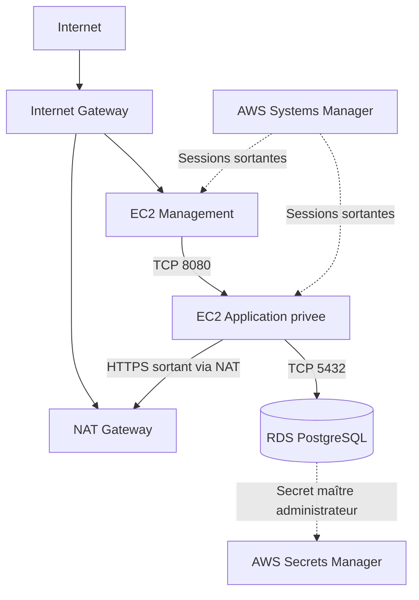
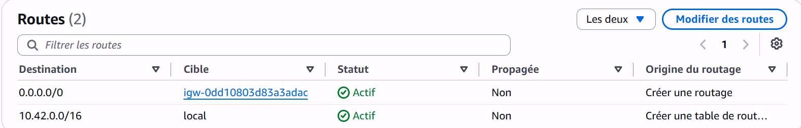
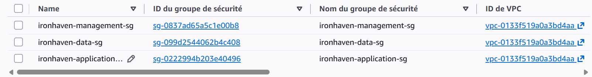
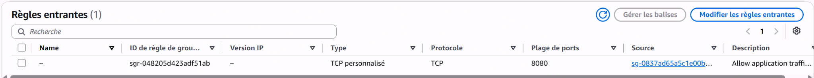
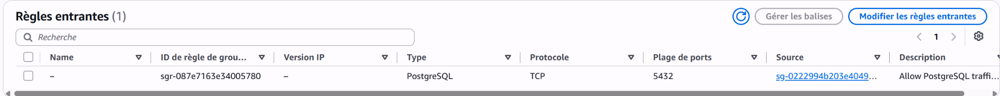
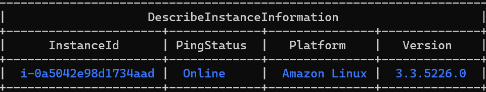
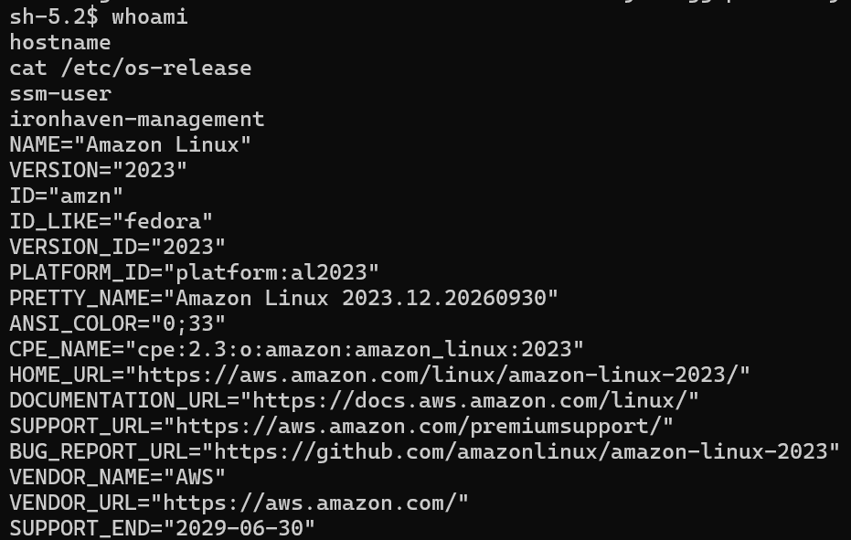
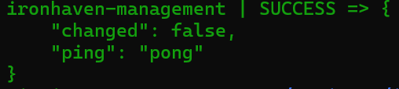

# Architecture AWS — Ironhaven

## Objectif

Ironhaven repose sur une architecture AWS segmentée en couches management, application et données afin de limiter les communications entre les ressources et de réduire leur surface d’exposition.

L’infrastructure est provisionnée avec Terraform dans la région `eu-west-3`. Sa configuration système, son durcissement et le déploiement du service de démonstration sont automatisés avec Ansible à travers AWS Systems Manager.

## Architecture générale

Le VPC utilise la plage `10.42.0.0/16` et quatre sous-réseaux.

| Subnet | CIDR | Zone | Fonction |
|---|---|---|---|
| Public | 10.42.10.0/24 | eu-west-3a | Management et NAT |
| Application | 10.42.20.0/24 | eu-west-3a | EC2 applicative privée |
| Data | 10.42.30.0/24 | eu-west-3b | RDS |
| Data secondaire | 10.42.31.0/24 | eu-west-3a | DB subnet group |

Les instances management et application utilisent des rôles IAM
distincts. Aucune règle entrante publique n'est configurée.

## Routage

Le subnet public possède une route par défaut
`0.0.0.0/0` vers l'Internet Gateway.

Le subnet applicatif possède une table de routage dédiée,
avec une route par défaut vers la NAT Gateway.

Les subnets de données conservent un routage local au VPC,
sans route Internet configurée par le projet.

La NAT Gateway a été déployée le 13 octobre 2026 avec :

- une Elastic IP ;
- une NAT Gateway publique ;
- une table de routage applicative privée ;
- une association au subnet `10.42.20.0/24`.

La NAT permet l'accès sortant aux API AWS et aux dépôts
de dépendances. Elle ne permet pas les connexions
entrantes non sollicitées depuis Internet.

Source Terraform : `routing.tf`.

## Segmentation par groupes de sécurité

Trois groupes de sécurité représentent les couches de l’architecture :

| Groupe de sécurité | Fonction |
|---|---|
| `ironhaven-management-sg` | Instance de management et composants d’administration |
| `ironhaven-application-sg` | Services applicatifs internes |
| `ironhaven-data-sg` | Instance PostgreSQL et services de données |

Les groupes de sécurité sont associés aux interfaces réseau des ressources et non directement aux sous-réseaux.

## Flux autorisés

| Source | Destination | Port | Usage |
|---|---|---|---|
| Management SG | Application SG | TCP 8080 | Service HTTP |
| Application SG | Data SG | TCP 5432 | PostgreSQL |
| Management | Internet | TCP 443 | API et dépendances |
| Application | Internet via NAT | TCP 443 | API et dépendances |
| Management/Application | Résolveur VPC | TCP/UDP 53 | DNS |

Les règles sont restrictives et utilisent des références
entre Security Groups pour les flux applicatifs.

Aucun accès entrant depuis Internet n'est autorisé.

## Instance de management

Une instance EC2 est déployée dans le sous-réseau public avec les caractéristiques suivantes :

| Paramètre | Valeur |
|---|---|
| Nom | `ironhaven-management` |
| Système | Amazon Linux 2023 |
| Type | `t3.micro` |
| Stockage | volume racine `gp3` de 8 Gio |
| Chiffrement | activé |
| Administration | Systems Manager et Ansible via SSM |
| SSH public | désactivé |
| IMDS | version 2 obligatoire |
| Suppression du volume | automatique avec l’instance |

L’instance dispose temporairement d’une adresse IPv4 publique afin de joindre les services AWS et les dépôts de paquets par HTTPS. Cette adresse ne permet pas d’initier une connexion entrante, car son groupe de sécurité ne contient aucune règle entrante.

## Administration avec Systems Manager

L’administration utilise la chaîne suivante :

1. l’utilisateur s’authentifie sur AWS avec son profil protégé par MFA ;
2. Systems Manager autorise l’ouverture d’une session ;
3. l’agent SSM établit une communication HTTPS sortante ;
4. le rôle IAM de l’instance fournit les autorisations nécessaires ;
5. la session permet l’exécution des commandes d’administration et des modules Ansible.

Aucune clé SSH, aucun mot de passe serveur et aucun port d’administration entrant ne sont nécessaires.

## Automatisation et service conteneurisé

Ansible s’exécute depuis WSL2 et utilise le plugin de connexion `amazon.aws.aws_ssm`. Les modules sont transférés temporairement à travers un bucket S3, puis exécutés sur l’instance via une session SSM.

Les playbooks appliquent une configuration Linux de base, le durcissement SSH, l’activation d’`auditd`, l’installation de Docker, la construction d’une image Nginx corrigée et la configuration de l’agent CloudWatch.

Le service Nginx de démonstration est lié à `127.0.0.1:8080` et n’est consultable depuis le poste local qu’à travers un tunnel SSM.

## Stockage temporaire Ansible

Le bucket S3 de transfert applique les contrôles suivants :

- blocage complet des accès publics ;
- chiffrement serveur `AES256` ;
- absence de versioning afin de ne pas conserver les modules temporaires supprimés ;
- expiration automatique des objets après un jour ;
- abandon des transferts multipart incomplets après un jour ;
- suppression automatique du contenu lors de la destruction contrôlée.

Le bucket ne constitue pas un stockage applicatif. Il sert uniquement aux transferts nécessaires au plugin Ansible SSM.

## Base de données PostgreSQL

Amazon RDS héberge PostgreSQL dans la couche de données. Le groupe de sous-réseaux RDS utilise deux sous-réseaux privés répartis entre `eu-west-3a` et `eu-west-3b`.

**Disponibilité :** l'instance reste configurée en `Single-AZ` (`multi_az = false`). La répartition des sous-réseaux ne constitue pas un déploiement RDS Multi-AZ et aucun basculement automatique n'a été testé.

| Paramètre | Valeur |
|---|---|
| Identifiant | `ironhaven-postgresql` |
| Classe | `db.t4g.micro` |
| Stockage | 20 Gio GP3, extensible jusqu’à 30 Gio |
| Chiffrement | activé au repos via AWS KMS ; clé gérée par le client non configurée explicitement |
| Accès public | désactivé |
| Déploiement | Single-AZ |
| Sauvegardes | conservation pendant un jour |
| Journaux exportés | PostgreSQL et mises à niveau |
| Authentification IAM | activée |
| Secret principal | généré et géré par RDS dans Secrets Manager |

Le mot de passe principal n’apparaît ni dans le code Terraform, ni dans ses outputs, ni dans le dépôt. Secrets Manager conserve le secret chiffré ; l'état de sa rotation périodique doit être vérifié.

Le détail de cette brique est disponible dans [database.md](database.md).

## Supervision

Terraform crée trois groupes CloudWatch Logs avec une rétention de sept jours :

- `/ironhaven/management/system` ;
- `/ironhaven/management/audit` ;
- `/ironhaven/management/containers`.

L'agent CloudWatch publie également les métriques mémoire et disque **de l'instance management** dans l'espace de noms `Ironhaven/Management`. RDS exporte ses journaux PostgreSQL et de mise à niveau vers CloudWatch.

Trois alarmes Terraform ont été créées et observées à l'état `OK` :

- CPU élevé sur l'EC2 management ;
- CPU élevé sur l'EC2 application ;
- stockage disponible RDS inférieur à 2 Gio.

Une transition d'état a été simulée via `SetAlarmState`.
Ce test confirme la modification et la consultation de l'état
d'une alarme, **pas un dépassement réel de seuil ni une
notification automatique**.

Détails et preuves : [monitoring.md](monitoring.md).

## IAM

Deux rôles sont attachés aux instances EC2.

### Management

- `ironhaven-management-role`
- `AmazonSSMManagedInstanceCore`
- `CloudWatchAgentServerPolicy`
- `ironhaven-management-profile`

### Application

- `ironhaven-application-role`
- `AmazonSSMManagedInstanceCore`
- `rds-db:connect` limité à l'utilisateur SQL `ironhaven_reader` ;
- aucun accès applicatif à `secretsmanager:GetSecretValue`
- `ironhaven-application-profile`

Le rôle applicatif dispose de `rds-db:connect` uniquement
pour le compte PostgreSQL `ironhaven_reader`.
Il ne dispose plus de `secretsmanager:GetSecretValue`.
Le secret maître reste géré par RDS dans Secrets Manager.

Le compte humain de déploiement `ironhaven-cli` dispose
temporairement de permissions étendues pour le laboratoire.
Il est distinct des rôles assumés par les instances.

Les deux EC2 ont été validées Online dans Systems Manager.

## Principes de sécurité

L’architecture applique actuellement les principes suivants :

- segmentation en couches management, application et données ;
- absence d’exposition directe des sous-réseaux privés ;
- filtrage des flux avec des références entre groupes de sécurité ;
- absence de règle entrante ouverte sur `0.0.0.0/0` ;
- administration avec Session Manager plutôt qu’avec SSH ;
- absence de clé privée d’administration ;
- rôles IAM dédiés aux workloads ;
- IMDSv2 obligatoire ;
- volumes EC2 et RDS chiffrés ;
- base PostgreSQL non publiquement accessible ;
- secret RDS absent du code ; rotation périodique à vérifier ;
- bucket temporaire privé, chiffré et soumis à expiration ;
- centralisation des journaux dans CloudWatch ;
- infrastructure reproductible avec Terraform ;
- exclusion du state Terraform et des informations sensibles du dépôt Git.

## État déployé et validé — octobre 2026

### Déployé et testé

- VPC et quatre subnets ;
- routage public et NAT Gateway ;
- deux instances EC2, dont une sans IP publique ;
- trois Security Groups ;
- rôles et instance profiles IAM dédiés ;
- administration via Systems Manager ;
- S3 temporaire pour Ansible ;
- Nginx conteneurisé sur management ;
- supervision CloudWatch de management ;
- PostgreSQL RDS privée ;
- secret maître géré dans Secrets Manager ;
- connexion SQL réelle depuis application.

## Validation finale du flux applicatif

Le flux trois tiers a été validé depuis l'EC2 management :

1. `management` contacte `application` en HTTP sur TCP 8080 ;
2. Flask/Gunicorn interroge RDS PostgreSQL sur TCP 5432 ;
3. le rôle IAM applicatif génère un jeton d'authentification ;
4. la connexion PostgreSQL vérifie le certificat RDS ;
5. l'API retourne trois enregistrements réels.

Le Security Group management dispose d'une règle sortante
TCP 8080 vers le Security Group application.
Le groupe application accepte ce trafic uniquement
depuis le groupe management.

Le rôle applicatif conserve `AmazonSSMManagedInstanceCore`
et la permission `rds-db:connect` dédiée à `ironhaven_reader`.
Il ne possède plus de permission de lecture du secret maître.

## Terraform Remote State — Amazon S3

L'état Terraform n'est plus stocké uniquement sur le poste
de développement. Il est hébergé dans un bucket S3 dédié,
indépendant du cycle de vie des ressources Ironhaven.

Le backend utilise le chiffrement SSE-S3, le versioning et
le verrouillage natif S3 (`use_lockfile = true`).

Les accès publics sont bloqués et une bucket policy refuse
les requêtes utilisant un transport non sécurisé.

Une sauvegarde locale préalable est conservée hors du dépôt.
La migration a été suivie d'un `terraform plan` confirmant
l'absence de modifications de l'infrastructure existante.

### Exploitation

Les opérations Terraform utilisent maintenant le backend S3.
La suppression du bucket de state ne fait pas partie du
`terraform destroy` de l'infrastructure principale.

Pour récupérer l'état, il faut disposer des autorisations
S3 appropriées. Le versioning permet de conserver les
anciennes versions des objets, sans remplacer une procédure
de restauration testée.

## Intégration GitHub Actions avec AWS IAM OIDC

L'intégration CI/CD utilise GitHub Actions et
AWS IAM Identity Provider (OIDC).

Le fournisseur OIDC AWS est configuré pour
`https://token.actions.githubusercontent.com`,
avec l'audience `sts.amazonaws.com`.

Le rôle `ironhaven-github-oidc-validation` utilise
`sts:AssumeRoleWithWebIdentity`.

Sa politique de confiance impose l'identité du dépôt
Ironhaven, sa branche `main` et l'audience attendue.

Après authentification, le workflow exécute
`aws sts get-caller-identity` et vérifie que l'ARN
correspond au rôle assumé.

Le rôle ne possède aucune politique de permissions
AWS attachée. Il n'autorise donc ni déploiement
Terraform, ni modification EC2, RDS ou S3.

### Bootstrap IAM

La politique `IronhavenOIDCBootstrap` reste attachée
à l'utilisateur IAM de développement `ironhaven-cli`
pendant les travaux sur le lab.

Elle autorise uniquement les opérations IAM ciblées
nécessaires à la création et à la consultation du
fournisseur OIDC et du rôle de validation.

Cette exception de bootstrap doit être réévaluée
avant toute utilisation en environnement professionnel.

### Preuves de validation

