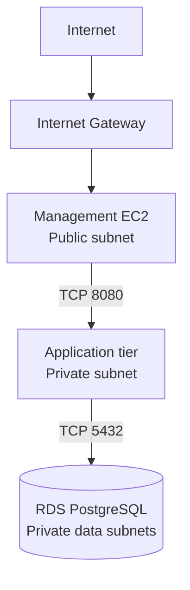

# Architecture AWS — Ironhaven

## Objectif

Ironhaven repose sur une architecture AWS segmentée en couches management, application et données afin de limiter les communications entre les ressources et de réduire leur surface d’exposition.

L’infrastructure est provisionnée avec Terraform dans la région `eu-west-3`. Sa configuration système, son durcissement et le déploiement du service de démonstration sont automatisés avec Ansible à travers AWS Systems Manager.

## Architecture générale

Le VPC utilise la plage privée `10.42.0.0/16` et contient quatre sous-réseaux :

| Sous-réseau | CIDR | Zone | Fonction |
|---|---|---|---|
| `ironhaven-public-subnet` | `10.42.10.0/24` | `eu-west-3a` | Instance de management et accès sortant direct |
| `ironhaven-private-app-subnet` | `10.42.20.0/24` | `eu-west-3a` | Futures ressources applicatives internes |
| `ironhaven-private-data-subnet` | `10.42.30.0/24` | `eu-west-3b` | Première zone de la couche de données |
| `ironhaven-private-data-secondary-subnet` | `10.42.31.0/24` | `eu-west-3a` | Seconde zone du groupe de sous-réseaux RDS |

Les couches application et données sont placées dans des sous-réseaux privés. Elles ne disposent actuellement d’aucune route directe vers Internet.

## Routage

Le sous-réseau public est associé à une table de routage contenant :

- une route locale `10.42.0.0/16` pour les communications internes au VPC ;
- une route par défaut `0.0.0.0/0` vers l’Internet Gateway.

Les trois sous-réseaux privés utilisent la table de routage principale du VPC, qui ne contient que la route locale.

Aucune NAT Gateway n’est déployée. Ce choix évite un coût permanent pendant la construction du projet et empêche les ressources privées d’accéder directement à Internet.

## Segmentation par groupes de sécurité

Trois groupes de sécurité représentent les couches de l’architecture :

| Groupe de sécurité | Fonction |
|---|---|
| `ironhaven-management-sg` | Instance de management et composants d’administration |
| `ironhaven-application-sg` | Services applicatifs internes |
| `ironhaven-data-sg` | Instance PostgreSQL et services de données |

Les groupes de sécurité sont associés aux interfaces réseau des ressources et non directement aux sous-réseaux.

## Flux autorisés

Le principe appliqué est celui du moindre privilège : seuls les flux nécessaires entre les différentes couches sont autorisés.

| Source | Destination | Protocole | Port | Usage |
|---|---|---:|---:|---|
| Management | Application | TCP | 8080 | Accès au service applicatif |
| Application | Data | TCP | 5432 | Accès à PostgreSQL |
| Management | Internet | TCP | 443 | Systems Manager, S3, CloudWatch et dépendances HTTPS |
| Application | Internet | TCP | 443 | Autorisé par le groupe, mais non routable sans NAT Gateway |
| Management/Application | Résolveur DNS du VPC | TCP/UDP | 53 | Résolution DNS |

Aucun accès entrant provenant directement d’Internet n’est autorisé.

### Flux management vers application

Le groupe `ironhaven-application-sg` accepte le trafic TCP sur le port `8080` uniquement lorsqu’il provient du groupe `ironhaven-management-sg`.

### Flux application vers données

Le groupe `ironhaven-data-sg` accepte PostgreSQL sur le port TCP `5432` uniquement lorsque le trafic provient du groupe `ironhaven-application-sg`.

La base n’accepte donc aucune connexion entrante depuis Internet ni directement depuis la couche management.

## Instance de management

Une instance EC2 est déployée dans le sous-réseau public avec les caractéristiques suivantes :

| Paramètre | Valeur |
|---|---|
| Nom | `ironhaven-management` |
| Système | Amazon Linux 2023 |
| Type | `t3.micro` |
| Stockage | volume racine `gp3` de 8 Gio |
| Chiffrement | activé |
| Administration | Systems Manager et Ansible via SSM |
| SSH public | désactivé |
| IMDS | version 2 obligatoire |
| Suppression du volume | automatique avec l’instance |

L’instance dispose temporairement d’une adresse IPv4 publique afin de joindre les services AWS et les dépôts de paquets par HTTPS. Cette adresse ne permet pas d’initier une connexion entrante, car son groupe de sécurité ne contient aucune règle entrante.

## Administration avec Systems Manager

L’administration utilise la chaîne suivante :

1. l’utilisateur s’authentifie sur AWS avec son profil protégé par MFA ;
2. Systems Manager autorise l’ouverture d’une session ;
3. l’agent SSM établit une communication HTTPS sortante ;
4. le rôle IAM de l’instance fournit les autorisations nécessaires ;
5. la session permet l’exécution des commandes d’administration et des modules Ansible.

Aucune clé SSH, aucun mot de passe serveur et aucun port d’administration entrant ne sont nécessaires.

## Automatisation et service conteneurisé

Ansible s’exécute depuis WSL2 et utilise le plugin de connexion `amazon.aws.aws_ssm`. Les modules sont transférés temporairement à travers un bucket S3, puis exécutés sur l’instance via une session SSM.

Les playbooks appliquent une configuration Linux de base, le durcissement SSH, l’activation d’`auditd`, l’installation de Docker, la construction d’une image Nginx corrigée et la configuration de l’agent CloudWatch.

Le service Nginx de démonstration est lié à `127.0.0.1:8080` et n’est consultable depuis le poste local qu’à travers un tunnel SSM.

## Stockage temporaire Ansible

Le bucket S3 de transfert applique les contrôles suivants :

- blocage complet des accès publics ;
- chiffrement serveur `AES256` ;
- absence de versioning afin de ne pas conserver les modules temporaires supprimés ;
- expiration automatique des objets après un jour ;
- abandon des transferts multipart incomplets après un jour ;
- suppression automatique du contenu lors de la destruction contrôlée.

Le bucket ne constitue pas un stockage applicatif. Il sert uniquement aux transferts nécessaires au plugin Ansible SSM.

## Base de données PostgreSQL

Amazon RDS héberge PostgreSQL dans la couche de données. Le groupe de sous-réseaux RDS utilise les deux sous-réseaux privés de données répartis entre `eu-west-3a` et `eu-west-3b`.

| Paramètre | Valeur |
|---|---|
| Identifiant | `ironhaven-postgresql` |
| Classe | `db.t4g.micro` |
| Stockage | 20 Gio GP3, extensible jusqu’à 30 Gio |
| Chiffrement | activé avec AWS KMS |
| Accès public | désactivé |
| Déploiement | Single-AZ |
| Sauvegardes | conservation pendant un jour |
| Journaux exportés | PostgreSQL et mises à niveau |
| Authentification IAM | activée |
| Secret principal | généré et géré par RDS dans Secrets Manager |

Le mot de passe principal n’apparaît ni dans le code Terraform, ni dans ses outputs, ni dans le dépôt. Secrets Manager conserve le secret chiffré et active sa rotation automatique.

Le détail de cette brique est disponible dans [database.md](database.md).

## Supervision

Terraform crée trois groupes CloudWatch Logs avec une rétention de sept jours :

- `/ironhaven/management/system` ;
- `/ironhaven/management/audit` ;
- `/ironhaven/management/containers`.

L’agent CloudWatch publie également les métriques mémoire et disque dans l’espace de noms `Ironhaven/Management`. RDS exporte ses journaux PostgreSQL et de mise à niveau vers CloudWatch.

## IAM

L’instance utilise les composants suivants :

| Composant | Fonction |
|---|---|
| `ironhaven-management-role` | Rôle assumé par EC2 |
| `AmazonSSMManagedInstanceCore` | Fonctionnement de l’agent SSM |
| `CloudWatchAgentServerPolicy` | Publication des journaux et métriques |
| `ironhaven-management-profile` | Instance profile attachant le rôle à EC2 |

Les identifiants AWS de l’utilisateur ne sont jamais copiés sur l’instance. Les identifiants PostgreSQL sont gérés séparément par Secrets Manager.

## Principes de sécurité

L’architecture applique actuellement les principes suivants :

- segmentation en couches management, application et données ;
- absence d’exposition directe des sous-réseaux privés ;
- filtrage des flux avec des références entre groupes de sécurité ;
- absence de règle entrante ouverte sur `0.0.0.0/0` ;
- administration avec Session Manager plutôt qu’avec SSH ;
- absence de clé privée d’administration ;
- rôles IAM dédiés aux workloads ;
- IMDSv2 obligatoire ;
- volumes EC2 et RDS chiffrés ;
- base PostgreSQL non publiquement accessible ;
- secret RDS absent du code et soumis à rotation ;
- bucket temporaire privé, chiffré et soumis à expiration ;
- centralisation des journaux dans CloudWatch ;
- infrastructure reproductible avec Terraform ;
- exclusion du state Terraform et des informations sensibles du dépôt Git.

## État actuel

Les éléments suivants sont actuellement provisionnés :

- un VPC ;
- quatre sous-réseaux répartis sur deux zones de disponibilité ;
- une Internet Gateway ;
- une table de routage publique et son association ;
- trois groupes de sécurité et leurs règles ;
- un rôle IAM et un instance profile pour l’instance de management ;
- une instance EC2 Amazon Linux 2023 avec volume chiffré ;
- un bucket S3 temporaire et ses contrôles de sécurité ;
- trois groupes CloudWatch Logs ;
- une configuration Ansible connectée par SSM ;
- un service Nginx conteneurisé ;
- un groupe de sous-réseaux RDS ;
- une instance Amazon RDS for PostgreSQL privée et chiffrée ;
- un secret principal RDS géré par Secrets Manager.

Les prochaines extensions prévues sont :

- une ressource de calcul dans la couche application privée ;
- une connexion applicative réelle vers PostgreSQL ;
- un rôle IAM applicatif limité à son secret ;
- les contrôles de sécurité dédiés au futur composant d’agent IA ;
- un test final de reconstruction et de destruction complète.
