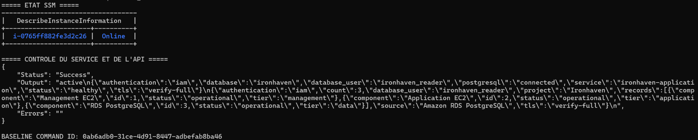
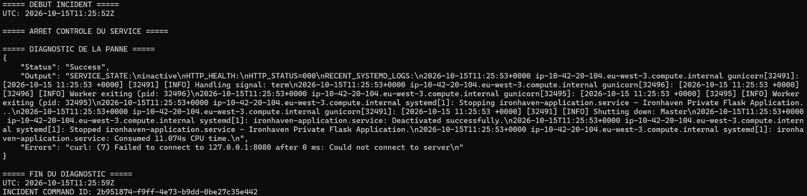
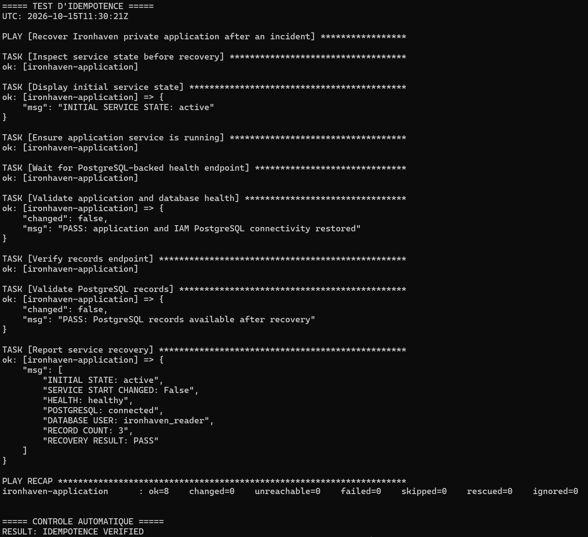

# Incident Recovery — Ironhaven

## Objectif

Démontrer la capacité à diagnostiquer et restaurer un service
applicatif Linux sur une instance EC2 privée.

L'administration passe par AWS Systems Manager et Ansible,
sans SSH entrant ni exposition publique de l'API.

## Environnement

- Région : AWS eu-west-3
- Instance : EC2 application privée, Amazon Linux 2023
- Service : `ironhaven-application.service`
- Application : Flask / Gunicorn, port TCP 8080
- Base : Amazon RDS PostgreSQL privée
- Authentification SQL : IAM, utilisateur `ironhaven_reader`
- TLS PostgreSQL : `sslmode=verify-full`
- Automatisation : `ansible/playbooks/incident-recovery.yml`

## Scénario

L'arrêt manuel de `ironhaven-application.service` simule
une interruption du service applicatif.

La panne est limitée à Flask/Gunicorn. L'instance EC2,
la connexion SSM, le réseau et la base RDS restent actifs.

Cette simulation ne représente pas une défaillance
matérielle, une perte du réseau ou une panne RDS.

## Chronologie observée

Toutes les heures sont exprimées en UTC, le 15 octobre 2026.

| Heure | Événement |
|---|---|
| Avant 11:25:52 | Service actif, API disponible, 3 enregistrements PostgreSQL |
| 11:25:52 | Début de la procédure d'incident contrôlé |
| 11:25:53 environ | Arrêt du service enregistré dans journalctl |
| Avant 11:25:59 | Service `inactive`, HTTP `000`, connexion refusée |
| 11:28:24 | Début du playbook Ansible de récupération |
| 11:28:38 | Fin du playbook, contrôles applicatifs réussis |
| 11:30:21 | Début de la vérification d'idempotence |

Les heures de démarrage et d'arrêt correspondent aux sorties
des commandes utilisées pendant l'exercice.

## Diagnostic

Les contrôles effectués via SSM ont démontré :

- `systemctl is-active` : `inactive` ;
- échec de connexion HTTP sur 127.0.0.1:8080 ;
- `HTTP_STATUS=000`, signifiant qu'aucune réponse HTTP
  n'a été reçue, et non un véritable code HTTP ;
- journaux systemd confirmant l'arrêt du service ;
- commande de diagnostic SSM exécutée avec succès.

L'incident était donc une interruption du processus
applicatif, et non une perte de connectivité SSM.

## Remédiation

Le playbook `ansible/playbooks/incident-recovery.yml` :

1. constate l'état initial de systemd ;
2. démarre le service lorsqu'il est arrêté ;
3. attend une réponse HTTP 200 de `/health` ;
4. valide la connexion PostgreSQL, l'authentification IAM
   et l'utilisation du mode TLS `verify-full` ;
5. contrôle `/records` et la présence de trois lignes.

Le premier passage a produit :

```text
INITIAL STATE: inactive
SERVICE START CHANGED: True
HEALTH: healthy
POSTGRESQL: connected
DATABASE USER: ironhaven_reader
RECORD COUNT: 3
RECOVERY RESULT: PASS

ok=8 changed=1 unreachable=0 failed=0
ANSIBLE_EXIT_CODE: 0
RECOVERY_PROCEDURE_SECONDS: 14
```

## Résultats et indicateurs

- Durée mesurée d'exécution du playbook : **14 secondes**.
- Temps entre début déclaré de l'incident et fin de la
  validation : **2 minutes 46 secondes**.
- Ce délai total inclut une attente volontaire avant
  le déclenchement de la récupération.
- HTTP `/health` : sain, PostgreSQL connecté.
- HTTP `/records` : trois enregistrements retrouvés.
- Aucun accès SSH public nécessaire.

Ces mesures constituent les résultats d'un exercice unique,
et non un RTO garanti ni une mesure statistique de disponibilité.

## Vérification de l'idempotence

Le second passage a constaté le service `active` et a terminé
avec :

```text
SERVICE START CHANGED: False
RECOVERY RESULT: PASS
ok=8 changed=0 unreachable=0 failed=0
RESULT: IDEMPOTENCE VERIFIED
```

Un service déjà opérationnel n'a donc pas été redémarré
inutilement pendant ce second passage.

## Preuves

### Avant incident



### Interruption constatée



### Récupération réussie


### Idempotence



## Limites et pistes d'amélioration

- Déclenchement manuel, sans détection automatique de la panne.
- Aucune notification SNS ou escalade opérationnelle.
- Aucune preuve de récupération après perte totale d'instance.
- Pas de restauration des données RDS ni de test de sauvegarde.
- Une reprise ne sera possible que si EC2, SSM et les
  dépendances restent suffisamment opérationnels.
- Aucun engagement de disponibilité ou RTO garanti.

Cet exercice valide une reprise de service applicatif,
pas un plan complet de reprise après sinistre.

## Validation finale du playbook corrigé

Après le premier exercice, le contrôle de l'état systemd
a été remplacé par le module natif Ansible `service_facts`
pour respecter les règles d'Ansible-lint.

Une nouvelle exécution sur l'instance applicative a confirmé :

- état initial : `running` (valeur retournée par `service_facts`) ;
- service conservé en fonctionnement, sans redémarrage ;
- API `/health` : `healthy` ;
- PostgreSQL : `connected`, utilisateur `ironhaven_reader` ;
- `/records` : 3 enregistrements ;
- Ansible : `ok=8`, `changed=0`, `failed=0`, `unreachable=0`.

Cette validation confirme l'idempotence de la version corrigée.
La reprise depuis un état arrêté avait été validée avec
la version précédente du playbook.
