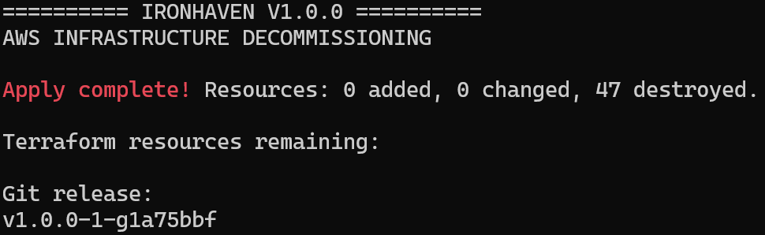

# Cycle de vie, sauvegarde et fermeture AWS — Ironhaven

## Périmètre

Ironhaven est un laboratoire AWS temporaire dans la région
`eu-west-3`, destiné à être intégralement supprimé après
validation de ses fonctionnalités.

Le code Terraform et Ansible, la documentation et les captures
restent dans GitHub. Le state Terraform réel et les secrets
ne doivent pas être publiés.

## Validation du 15 octobre 2026

Contrôles effectivement réalisés :

- `terraform validate` : configuration valide ;
- `terraform plan -detailed-exitcode` : code de sortie `0`,
  aucune différence entre infrastructure et configuration ;
- state téléchargé depuis le backend S3, analysé comme JSON
  et conservé localement hors dépôt ;
- bucket de state S3 vérifié avec `head-object` ;
- deux EC2 `t3.micro` observées à l'état `running` ;
- une NAT Gateway observée à l'état `available` ;
- RDS PostgreSQL `db.t4g.micro`, 20 Gio, observé `available` ;
- bucket S3 de transfert Ansible et bucket de state recensés ;
- trois alarmes CloudWatch observées à l'état `OK` ;
- GitHub Actions : audit IaC Trivy et Ansible-lint
  bloquants validés, avec quatre risques IaC acceptés.

La validation du bootstrap PostgreSQL sur base existante,
les contrôles IAM/TLS et la simulation d'alarme sont décrits
dans les autres documents du projet.

Une reconstruction intégrale depuis zéro n'a pas été validée.

## Sauvegarde locale

Le state a été conservé sur le poste WSL dans :

`~/ironhaven-state-backup/terraform-final-2026-10-15.tfstate`

Ce chemin est local au poste de développement et n'est
pas un artefact GitHub.

Le fichier peut contenir des valeurs sensibles et doit
rester privé. Une copie chiffrée sur un support indépendant
reste recommandée pour l'archivage privé.

## Destruction et clôture — 15 octobre 2026

Le démantèlement du laboratoire a été exécuté après les
validations techniques et la publication du tag `v1.0.0`.

### Résultat Terraform

Un plan de destruction a été vérifié avant exécution :

- `0` ressource à créer ;
- `0` ressource à modifier ;
- `47` ressources à détruire.

L'exécution du plan s'est terminée par :

```text
Apply complete! Resources: 0 added, 0 changed, 47 destroyed.
```

La commande `terraform state list` n'a ensuite retourné
aucune ressource.

Les deux instances EC2, RDS PostgreSQL, la NAT Gateway,
l'Elastic IP, les sous-réseaux et le VPC ont été supprimés.
Aucun snapshot RDS final n'a été conservé.



### Nettoyage complémentaire hors Terraform

Les opérations suivantes ont été réalisées et vérifiées :

- suppression du bucket S3 de state distant, après suppression
  de ses 15 versions et 9 marqueurs de suppression ;
- suppression des quatre groupes CloudWatch Logs résiduels,
  dont trois provenant de l'ancien laboratoire Drakonis ;
- suppression du rôle IAM de validation GitHub OIDC et
  du fournisseur d'identité associé ;
- vérification de l'absence de buckets S3 restants ;
- inventaire de 17 régions AWS : aucune ressource active
  trouvée dans les catégories EC2, EBS, Elastic IP,
  NAT Gateway, RDS, CloudWatch Logs et Secrets Manager
  interrogées.

Cet inventaire ne constitue pas une vérification exhaustive
de l'ensemble des services AWS existants.

### Vérifications financières

La console Billing affichait une facture estimée à
`0,00 USD` pour octobre 2026, couverte par le plan gratuit.
Ce montant était provisoire et ne prouve pas une absence
totale de consommation.

Les écrans consultés montraient :

- zéro Savings Plan ;
- aucune instance EC2 réservée dans la région vérifiée ;
- zéro abonnement AWS Marketplace actif.

Le compte AWS a été **conservé ouvert** pour d'éventuels
projets futurs. La fermeture du compte n'a pas été effectuée.

### Conservation des preuves

Le dépôt GitHub, le tag `v1.0.0`, les scripts et les
captures sont conservés.

Le state Terraform historique et le journal de destruction
restent en dehors du dépôt public, sur le poste WSL.

Le workflow GitHub OIDC est conservé comme démonstration
historique : son rôle et son fournisseur d'identité AWS
n'existent plus.

## Limites

Le verrouillage natif S3 `use_lockfile = true` est configuré,
mais aucun test concurrent explicite n'a été réalisé.

Le state sauvegardé n'est pas une sauvegarde complète des
données d'une instance RDS ni des ressources AWS détruites.

La reprise d'un environnement dans un nouveau compte cloud
nécessiterait notamment de recréer les dépendances IAM,
les données SQL et le backend Terraform.
