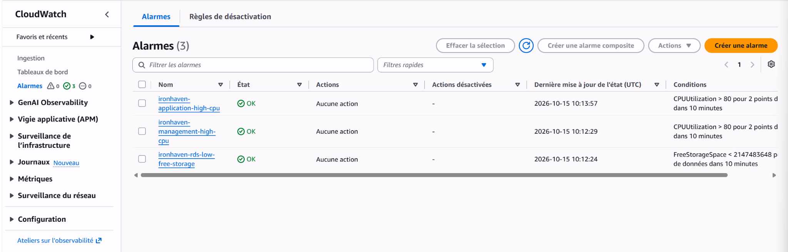
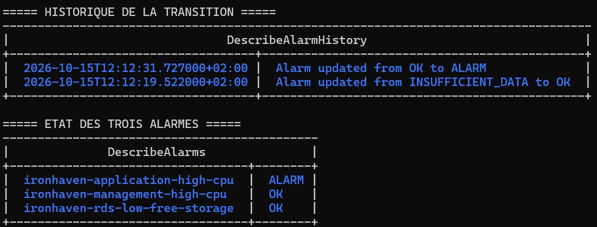

# Supervision avec Amazon CloudWatch — Ironhaven

## Objectif

Ironhaven centralise les journaux et les métriques de l’instance de management dans Amazon CloudWatch.

Cette supervision permet de :

- consulter les journaux sans ouvrir de connexion SSH ;
- centraliser les événements système, d’audit et de conteneur ;
- surveiller l’utilisation de la mémoire et du disque ;
- conserver les données pendant une durée limitée ;
- reproduire la configuration avec Terraform et Ansible.

## Architecture

La supervision repose sur deux niveaux d’automatisation :

| Outil | Responsabilité |
|---|---|
| Terraform | Création des groupes de journaux CloudWatch, définition de leur rétention et attribution des permissions IAM |
| Ansible | Installation et configuration de l’agent CloudWatch sur l’instance EC2 |

L’agent CloudWatch communique avec les services AWS en HTTPS grâce au rôle IAM associé à l’instance. Aucune clé d’accès AWS n’est stockée sur la machine.

## Ressources Terraform

Le fichier `terraform/monitoring.tf` crée trois groupes de journaux :

| Groupe de journaux | Source | Utilisation |
|---|---|---|
| `/ironhaven/management/system` | `/var/log/cloud-init-output.log` | Initialisation et démarrage de l’instance |
| `/ironhaven/management/audit` | `/var/log/audit/audit.log` | Événements produits par `auditd` |
| `/ironhaven/management/containers` | `/var/lib/docker/containers/*/*.log` | Journaux des conteneurs Docker |

Une durée de rétention de sept jours est appliquée aux trois groupes afin de limiter le stockage et les coûts du laboratoire.

Le rôle IAM de l’instance reçoit également la politique AWS gérée `CloudWatchAgentServerPolicy`. Cette politique permet à l’agent d’envoyer les journaux et les métriques nécessaires sans utiliser les identifiants de l’utilisateur IAM local.

## Configuration Ansible

Le playbook `ansible/playbooks/monitoring.yml` réalise les opérations suivantes :

1. installation du paquet `amazon-cloudwatch-agent` ;
2. création du fichier de configuration Ironhaven ;
3. application de la configuration ;
4. activation et démarrage du service ;
5. vérification de l’état de l’agent.

La configuration est enregistrée dans :

```text
/opt/aws/amazon-cloudwatch-agent/etc/ironhaven-cloudwatch-agent.json
```

Un fichier distinct du fichier interne de l’agent est utilisé afin que les exécutions Ansible restent idempotentes.

## Métriques collectées

Les métriques personnalisées sont publiées dans l’espace de noms :

```text
Ironhaven/Management
```

| Métrique | Fonction | Intervalle |
|---|---|---:|
| `mem_used_percent` | Pourcentage de mémoire utilisée | 60 secondes |
| `disk_used_percent` | Pourcentage d’espace utilisé sur la partition racine | 60 secondes |

La dimension `InstanceId` permet d’associer les mesures à l’instance EC2 supervisée. CloudWatch peut publier une même métrique de disque avec plusieurs combinaisons de dimensions, notamment le périphérique, le type de système de fichiers et le chemin de montage.

## Flux de journaux

Chaque groupe contient un flux identifié par l’ID de l’instance :

```text
i-0a5042e98d1734aad/cloud-init
i-0a5042e98d1734aad/audit
i-0a5042e98d1734aad/docker
```

L’identifiant d’instance n’est pas une information d’authentification et peut être conservé dans la documentation publique du projet.

## Validation

L’état de l’agent est contrôlé automatiquement par le playbook. Une seconde exécution ne provoque aucune modification :

```text
changed=0
unreachable=0
failed=0
```

Ce résultat confirme l’idempotence de la configuration.

Les flux de journaux peuvent être vérifiés avec AWS CLI :

```bash
for LOG_GROUP in \
  "/ironhaven/management/system" \
  "/ironhaven/management/audit" \
  "/ironhaven/management/containers"
do
  AWS_PROFILE=ironhaven aws logs describe-log-streams \
    --log-group-name "$LOG_GROUP" \
    --order-by LastEventTime \
    --descending \
    --max-items 1 \
    --output table
done
```

Les métriques peuvent être vérifiées avec :

```bash
AWS_PROFILE=ironhaven aws cloudwatch list-metrics \
  --namespace "Ironhaven/Management" \
  --output table
```

La validation confirme la présence des trois flux de journaux ainsi que des métriques de mémoire et de disque.


## Sécurité

La solution applique les contrôles suivants :

- aucun port entrant supplémentaire n’est ouvert ;
- aucun identifiant AWS n’est enregistré sur l’instance ;
- les permissions sont fournies par un rôle IAM associé à EC2 ;
- les échanges avec CloudWatch utilisent HTTPS ;
- les journaux sont séparés selon leur fonction ;
- leur rétention est limitée à sept jours ;
- Terraform conserve la responsabilité du cycle de vie des groupes de journaux ;
- Ansible conserve la responsabilité de la configuration de l’agent.

## Maîtrise des coûts

La configuration reste adaptée à un environnement de laboratoire :

- collecte toutes les 60 secondes ;
- deux types de métriques personnalisées sur management
  (mémoire et disque), avec leurs dimensions CloudWatch ;
- trois sources de journaux ciblées ;
- rétention limitée à sept jours ;
- trois alarmes CloudWatch standards déployées, sans action automatique ;
- arrêt de l’instance EC2 lorsqu’elle n’est pas utilisée.

## État actuel

La brique de supervision est opérationnelle :

- les trois groupes de journaux existent ;
- les événements système, d’audit et Docker sont centralisés ;
- les métriques mémoire et disque sont publiées ;
- l’agent CloudWatch est actif ;
- le playbook Ansible est idempotent ;
- l’infrastructure Terraform ne présente aucune dérive connue.

## Alarmes CloudWatch et simulation d'incident

Le fichier `terraform/alarms.tf` provisionne trois alarmes
CloudWatch indépendantes :

| Alarme | Condition |
|---|---|
| `ironhaven-application-high-cpu` | CPU > 80 %, 2 périodes de 5 minutes |
| `ironhaven-management-high-cpu` | CPU > 80 %, 2 périodes de 5 minutes |
| `ironhaven-rds-low-free-storage` | Stockage libre < 2 Gio, 2 périodes de 5 minutes |

Les alarmes CPU utilisent une période de 300 secondes, cohérente
avec les métriques EC2 du monitoring basique.

Aucune action automatique n'est associée aux alarmes : ni arrêt
d'instance, ni redémarrage, ni notification SNS.

### Validation du déploiement

Terraform a créé exactement trois alarmes, sans modification
ni suppression des ressources existantes.

Les trois alarmes ont ensuite été observées à l'état `OK`.



### Simulation contrôlée

L'API `SetAlarmState` a été utilisée pour forcer temporairement
l'alarme applicative à l'état `ALARM`.

L'historique CloudWatch a enregistré une transition
`OK → ALARM`. L'alarme est ensuite revenue à `OK`
lors de l'évaluation normale des métriques.



Cette manipulation démontre la gestion des états et la
traçabilité CloudWatch. **Elle ne simule pas une réelle
surcharge CPU**, ne valide pas la détection automatique
d'une panne applicative et ne démontre pas l'envoi d'une
notification.

Les alarmes CPU EC2 utilisent les métriques AWS/EC2 ;
elles sont distinctes des métriques personnalisées
mémoire et disque envoyées par l'agent sur management.

Les alarmes peuvent entraîner des frais CloudWatch
selon les conditions du compte AWS.
