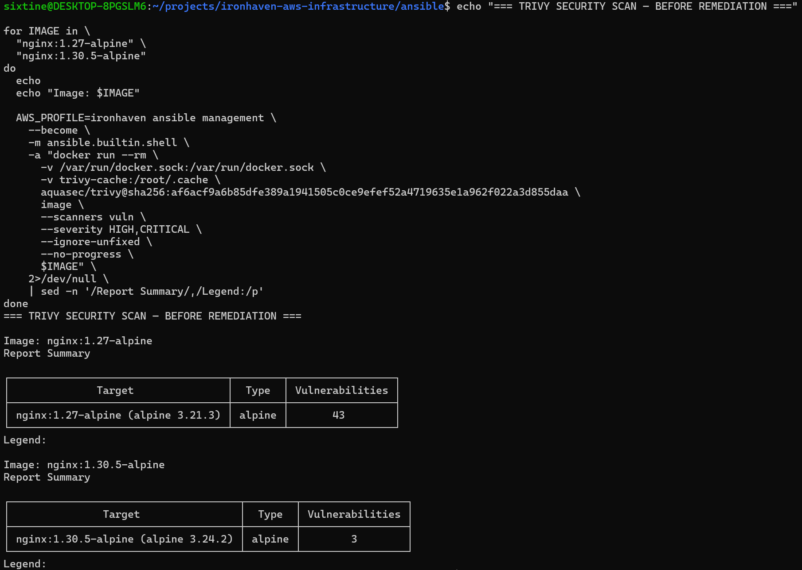
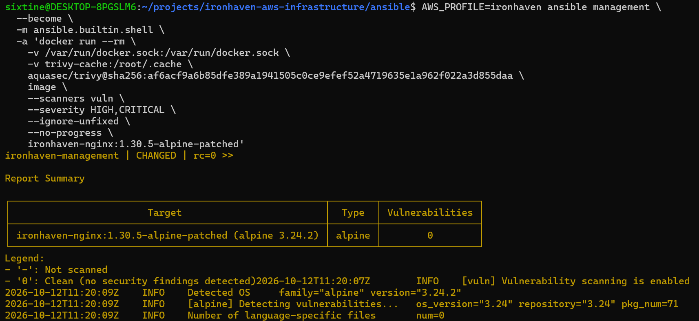
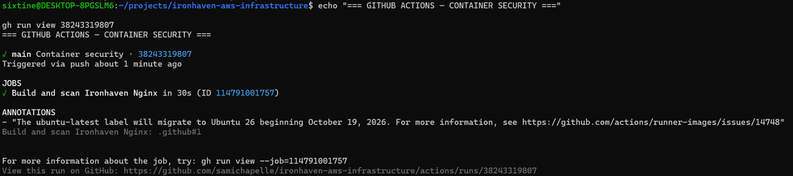

# Analyse de sécurité des conteneurs — Ironhaven

## Objectif

Ironhaven utilise Trivy pour identifier les vulnérabilités connues dans l’image Nginx avant son déploiement.

Le contrôle porte sur les vulnérabilités :

- de sévérité `HIGH` ou `CRITICAL` ;
- disposant déjà d’un correctif ;
- présentes dans les paquets du système Alpine embarqué dans l’image.

Cette approche évite de considérer une image officielle comme automatiquement sûre et permet d’intégrer la vérification au cycle de développement.

## Analyse initiale

L’image initialement utilisée était :

```text
nginx:1.27-alpine
```

Le premier scan a identifié :

| Image | Base | HIGH | CRITICAL | Total |
|---|---|---:|---:|---:|
| `nginx:1.27-alpine` | Alpine 3.21.3 | 41 | 2 | 43 |

Les vulnérabilités provenaient principalement de bibliothèques système anciennes, notamment OpenSSL, Expat, libpng, libxml2, musl et zlib.

## Mise à jour de l’image officielle

Le passage à l’image officielle stable `nginx:1.30.5-alpine` a réduit le nombre de vulnérabilités :

| Image | Base | HIGH | CRITICAL | Total |
|---|---|---:|---:|---:|
| `nginx:1.30.5-alpine` | Alpine 3.24.2 | 3 | 0 | 3 |

Les trois vulnérabilités restantes concernaient `libexpat`, `pcre2` et `tiff`. Des versions corrigées étant disponibles, elles n’ont pas été acceptées comme risque résiduel.



## Remédiation

Une image propre au projet est construite à partir de `nginx:1.30.5-alpine`.

Le fichier `ansible/files/nginx/Dockerfile` applique les mises à jour disponibles pendant le build :

```dockerfile
FROM nginx:1.30.5-alpine

RUN apk upgrade --no-cache
```

Le playbook `ansible/playbooks/container.yml` :

1. copie le Dockerfile sur l’instance de management ;
2. construit l’image `ironhaven-nginx:1.30.5-alpine-patched` ;
3. remplace le conteneur existant ;
4. attend la disponibilité du service ;
5. valide le contenu de la réponse HTTP.

Une seconde exécution du playbook produit :

```text
changed=0
unreachable=0
failed=0
```

Le déploiement reste donc idempotent après l’ajout du build personnalisé.

## Résultat après remédiation

Le scan de l’image corrigée retourne :

| Image | Base | HIGH | CRITICAL | Total |
|---|---|---:|---:|---:|
| `ironhaven-nginx:1.30.5-alpine-patched` | Alpine 3.24.2 | 0 | 0 | 0 |



Ce résultat ne signifie pas que l’image restera définitivement sans vulnérabilité. De nouvelles CVE peuvent être publiées après sa construction. Le scan doit donc être répété automatiquement.

## Validation continue avec GitHub Actions

Le workflow `.github/workflows/container-security.yml` s’exécute :

- lors d’un push sur `main` ;
- lors d’une pull request vers `main` ;
- manuellement avec `workflow_dispatch`.

Le workflow réalise les opérations suivantes :

1. récupération du dépôt ;
2. reconstruction de l’image Ironhaven ;
3. analyse avec Trivy ;
4. échec du job si une vulnérabilité corrigible `HIGH` ou `CRITICAL` est détectée.

L’option suivante transforme le scan en contrôle bloquant :

```text
--exit-code 1
```

Si Trivy détecte une vulnérabilité correspondant à la politique, il renvoie le code de sortie `1` et GitHub Actions marque le job comme échoué.

Le workflow a été exécuté avec succès sur la branche `main`. GitHub Actions a reconstruit l’image et terminé le job `Build and scan Ironhaven Nginx` sans détection bloquante.



## Pourquoi il s’agit d’un pipeline CI

Le workflow actuel relève de l’intégration continue, ou CI. À chaque modification du dépôt, il vérifie automatiquement que l’image peut être construite et qu’elle respecte la politique de sécurité définie par le projet.

Il ne constitue pas encore un pipeline CI/CD complet : l’image validée n’est ni publiée automatiquement dans un registre, ni déployée automatiquement sur l’infrastructure AWS.

Une évolution vers la livraison ou le déploiement continu pourrait ajouter :

1. une authentification temporaire auprès d’AWS avec GitHub OIDC, sans clé d’accès permanente ;
2. la publication de l’image validée dans Amazon ECR ;
3. le déploiement sur l’instance avec Systems Manager ou Ansible ;
4. un test HTTP après déploiement ;
5. une procédure de retour arrière en cas d’échec.

Cette extension n’est pas activée à ce stade afin de conserver un périmètre maîtrisé et de ne pas accorder à GitHub Actions des droits de déploiement inutiles au besoin actuel.

## Sécurisation de la chaîne d’approvisionnement

Le workflow ne repose pas sur des références mutables telles que `latest`.

Les dépendances externes sont épinglées :

- `actions/checkout` utilise un SHA Git complet ;
- l’image du scanner Trivy utilise un digest SHA-256 ;
- l’image de base Nginx utilise une version explicite.

Cette mesure réduit le risque qu’un tag existant soit déplacé vers un contenu différent à l’insu du projet.

L’image Nginx est reconstruite avec `--pull` afin de récupérer les mises à jour publiées pour la version sélectionnée, puis elle est systématiquement analysée avant validation.

## Limites

Le contrôle actuel se concentre sur les vulnérabilités des paquets du conteneur. Il ne remplace pas :

- une analyse dynamique de l’application ;
- une revue de la configuration Nginx ;
- une surveillance continue en production ;
- un processus régulier de mise à jour des versions ;
- une signature et une vérification cryptographique des images produites.

Ces éléments constituent des améliorations possibles pour une utilisation au-delà du laboratoire.
